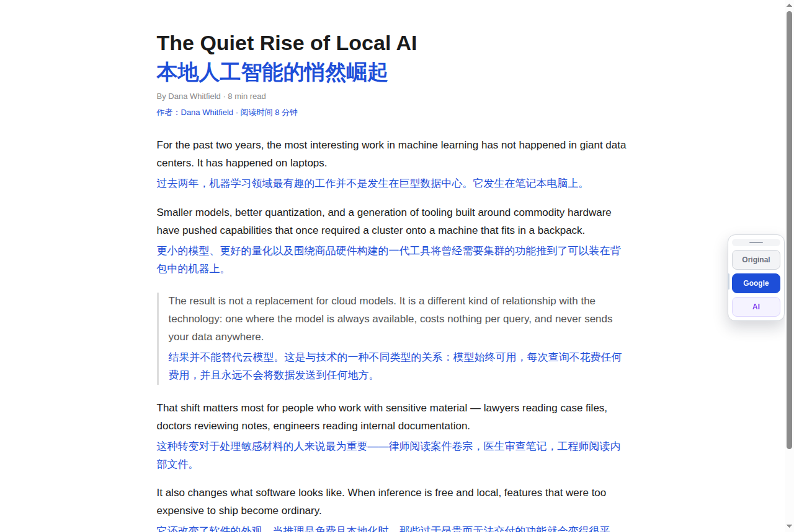

# DualTran

**Bilingual translation that keeps the original on the page** — the translation sits under each
paragraph instead of replacing it. Google Translate works out of the box; bring your own key for
20+ AI providers.

[](https://chromewebstore.google.com/detail/dualtran/ihbcniigknaeillehompenjaacaocpnp)
[](https://addons.mozilla.org/zh-CN/firefox/addon/dualtran/)
[](https://microsoftedge.microsoft.com/addons/detail/dualtran/jlgcpdcmakcfidfndifanijipfchnjoc)

> 安卓：Kiwi / Lemur / Mises 装 Chrome 商店包，Firefox for Android 装 AMO 包 —— [安装指引](https://seigwen.github.io/DualTran-extension/android.html)
[](https://community.obsidian.md/plugins/dualtran-translate)

[Website](https://seigwen.github.io/DualTran-extension/) · [English](#features)



AI-powered browser extension that translates web pages and displays the translated text alongside the original text in the same page.

Based on [Traduzir-paginas-web](https://github.com/FilipePS/Traduzir-paginas-web) by FilipePS, with significant enhancements for AI-powered translation.

## Features

### Translation Services
- **Google Translate** - Fast and reliable web page translation
- **AI Translation** - Leverage LLM models for higher quality translations
- **Dual Display** - Show translated text alongside original text

### AI Provider Support (20+ providers)

| Category | Providers |
|----------|-----------|
| **Global** | OpenAI, Anthropic, Google Gemini, Mistral, Cohere, Together AI, Groq, Perplexity, xAI (Grok) |
| **Aggregator** | OpenRouter (300+ models) |
| **Enterprise** | Azure OpenAI |
| **China** | DeepSeek, 智谱AI (GLM), 月之暗面 (Moonshot), 阿里通义千问 (Qwen), 百度文心 (ERNIE), 字节豆包 (Doubao), 讯飞星火 (iFlytek) |
| **Additional** | Deep Infra, Cerebras, Vercel AI Gateway |

### Key Capabilities
- 🔄 **One-click Translation** - Translate entire pages with a single click
- 📝 **Selected Text Translation** - Translate selected text in a popup
- 🎯 **Smart Translation** - AI improves Google translations for better quality
- ⌨️ **Keyboard Shortcuts** - `Alt+T` toggle, `Alt+S` translate selection, `Alt+Q` switch service
- 🌍 **Multi-language Support** - Supports 100+ languages
- 🎨 **Customizable Display** - Configure how translations appear (side-by-side, replace, etc.)

## Installation

### From Source (Developer Mode)

1. Clone this repository:
   ```bash
   git clone https://github.com/seigwen/DualTran-extension.git
   cd DualTran-extension
   ```

2. Install dependencies:
   ```bash
   npm install
   ```

3. Build the extension:
   ```bash
   npm run build
   ```

4. Load in Chrome:
   - Open `chrome://extensions/`
   - Enable "Developer mode"
   - Click "Load unpacked"
   - Select the `dist/chrome/` folder

### Development

For development with auto-rebuild:
```bash
npm run dev
```

## Configuration

### Setting up AI Providers

1. Click the extension icon and go to **Settings**
2. Select an AI provider from the dropdown
3. Enter your API key
4. Choose a model

### Translation Modes

- **Google Only** - Use Google Translate
- **AI Only** - Use AI for translation
- **Google + AI** - Use Google first, then improve with AI

## Building

```bash
# Development build (watch mode)
npm run dev

# Production build
npm run build
```

Output goes to `dist/chrome/`.

## Core Library (`src/core`)

The translation engine — provider registry, models.dev transport, prompt
builders, Google engine, caches — lives in `src/core/`: a host-free layer with
zero `chrome.*` dependencies, designed for reuse outside the extension
(other browsers, workbench apps, agents). The extension imports it through
thin shims kept at the original paths.

```bash
# Bundle the core (ESM; SDK deps stay external) into dist-core/
npm run build:core

# Run the engine from Node — proves the two translation paths work outside Chrome
node scripts/tx-cli.mjs google --to zh --from en --text "Hello world"
node scripts/tx-cli.mjs ai --provider openai --model gpt-4o-mini \
  --base http://127.0.0.1:8788/openai/v1 --key test --to zh --text "Hello"
```

The boundary is enforced by `npm run lint:core-boundary` (wired into
`npm run verify`): no host globals in code, no imports escaping `src/core/`.
Every host capability (storage, fetch, caches, page hostname) is injected by
the caller. Provenance/licensing: see [PROVENANCE.md](PROVENANCE.md).

## Testing

```bash
# Run unit tests
npm test

# Run with coverage
npm run test:coverage

# Run E2E tests
npm run test:browser-e2e
```

## Project Structure

```
src/
├── background/        # Service Worker (background scripts)
├── contentScript/     # Content scripts (injected into web pages)
├── core/              # Host-free translation engine (see "Core Library")
├── lib/               # Shared libraries
│   ├── ai/           # AI provider system
│   └── config.js     # Configuration management
├── options/           # Settings page
├── popup/             # Extension popup
└── manifest.json      # Extension manifest
```

## Contributing

Please read [CONTRIBUTING.md](CONTRIBUTING.md) for details on our code of conduct and the process for submitting pull requests.

## License

This project is licensed under the Mozilla Public License 2.0 - see the [LICENSE](LICENSE) file for details.

## Acknowledgments

- Original project: [Traduzir-paginas-web](https://github.com/FilipePS/Traduzir-paginas-web) by FilipePS
- AI SDK: [Vercel AI SDK](https://sdk.vercel.ai/)

## Privacy

See [Privacy Policy](privacy-policies/index.html) for details on data handling.

## Support

- [Report Issues](https://github.com/seigwen/DualTran-extension/issues)
- [Feature Requests](https://github.com/seigwen/DualTran-extension/issues/new?template=feature_request.md)
